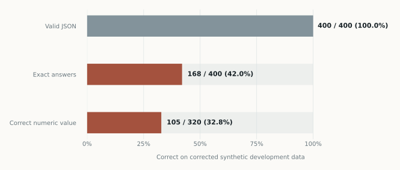
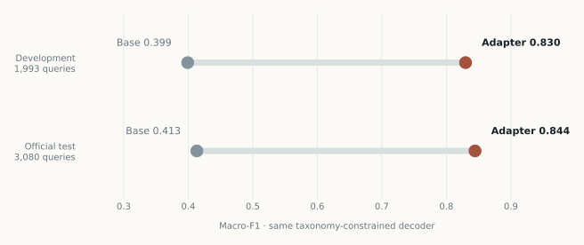
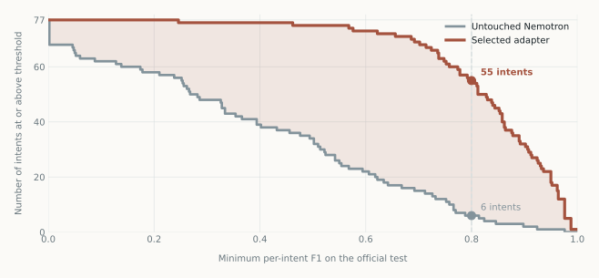

# I post-trained Nemotron 4B into an Average Banker

*A model that gets 84.9% of banking-support labels right is useful for an experiment. I would still keep it away from the counter.*

I gave NVIDIA's 4B Nemotron model a small job: read a customer's banking-support question and choose one of 77 possible reasons they might be asking. Before training, it chose the right label for 42.5% of the official test questions. After one short adapter run, it got 84.9% right.

That is the entire claim behind the title. “Average banker” is a joke, not a comparison with a person. No human bankers were tested. The model did not move money, resolve disputes, or decide what advice to give a customer. It sorted short requests into the labels of a public benchmark.

## A small false start

I began with a different task. I wrote fictional financial snippets and asked Nemotron to extract numbers, calculate differences or growth, and return strict JSON with supporting evidence. The first data generator had leakage: an identifier revealed where an example came from. I discarded those results, corrected the generator, and started again.

The corrected one-epoch adapter returned valid JSON for all 400 development questions. It answered 168 exactly. On the 320 questions with a numeric answer, only 105 numeric values were correct. A deterministic parser operating on the same document and question solved all 400. The model had learned much more about the answer format than about arithmetic. I did not evaluate the held-out synthetic test or robustness split.

*Corrected synthetic development data only. The numeric row uses the 320 answerable questions; the other rows use all 400.*

That result was useful because it forced a better question. If a small adapter was going to change Nemotron's behavior, what job could I measure without confusing a good-looking answer with a good answer?

## Give it one job

[BANKING77](https://github.com/PolyAI-LDN/task-specific-datasets) contains short banking-support queries assigned to 77 intent labels. A request to activate a card is different from one about a card payment that was declined. A pending transfer is different from a transfer that never arrived. Some labels are close enough that a wrong choice would matter in a real support queue.

I took 2,308 examples from the publisher's training set, capped at 30 per intent, and held out 1,993 more for development. I grouped normalized duplicates so near-identical text would not quietly cross that boundary. The publisher's 3,080 official test queries stayed sealed until the training recipe and checkpoint choice were fixed.

The model trained for one epoch on a single RTX 4090. I used QLoRA: the original model stayed quantized while a small rank-16 adapter learned the task. The run took 289 optimizer steps and about 19.5 minutes of training time. Downloading the model, checking the environment, evaluating both versions, and exporting artifacts took longer than training itself.

Here is the decision the model faced on each query: choose exactly one label from the same full list of 77. For the main comparison, both untouched Nemotron and the adapter used the same prompt and a decoder that could emit only valid labels. This matters because otherwise a tuned model can look better merely by learning how to spell the answer.

## What changed

On development, untouched Nemotron got 813 of 1,993 questions right, or 40.8%. The adapter got 1,655 right, or 83.0%. Macro-F1, which gives each intent equal weight, rose from 0.399 to 0.830. The predeclared development gate passed, so I selected that completed one-epoch checkpoint before opening the official test.

One development example asked how to activate a card. The base model called it `card_acceptance`; the adapter chose `activate_my_card`. Another asked about the number of currencies a customer could hold. The adapter moved it to `fiat_currency_support`. These examples help explain the gain, but I selected them after seeing the development errors. They are illustrations, not an independent test.

The errors did not vanish. “The top-up did not go through” moved from the correct `top_up_failed` to `pending_top_up`. The model also confused some transfer charges with transfer fees and some unrecognized withdrawals with pending withdrawals. A label can be nearly right in language and wrong for the customer.

There was a humbling CPU comparison too. A TF-IDF logistic classifier trained on the same examples scored 0.829 macro-F1 on development, almost identical to the adapter's 0.830. The experiment was about improving Nemotron over its own baseline. It did not show that a neural adapter was the cheapest or best way to build this particular classifier.

## The official test

Once the checkpoint was fixed, I ran the untouched model and the adapter once each on all 3,080 official test questions. The adapter got 2,614 right, or 84.9%. The untouched model got 1,310 right, or 42.5%. Macro-F1 rose from 0.413 to 0.844. The paired macro-F1 gain was 0.431, with a 95% group-bootstrap interval of 0.415 to 0.449.

*Both conditions used the same taxonomy-constrained decoder. The official paired macro-F1 gain was 0.431, 95% group-bootstrap interval [0.415, 0.449].*

The gain was spread across labels. All 77 intents had higher F1 on the official test after adaptation. At a per-intent F1 of 0.8 or better, the count rose from six intents for the base to 55 for the adapter. This is a descriptive look at the already-scored test, not another selection rule.

*An empirical distribution over the 77 intent scores, not a training curve. The per-class aggregate values are in `results/BANKING77_PER_CLASS.json`.*

The constrained score is the main result. I also let the models answer without the label constraint to see how often they broke the required format. The base produced 396 malformed answers; the adapter produced five. That is a useful format improvement, but it is separate from the apples-to-apples constrained score.

An audit flagged five official queries for overlap or conflicting labels: three matched the capped train or development material and two belonged to a conflicting-label group within the test. I kept all 3,080 in the primary result. Excluding those five only as a sensitivity check barely moved the macro-F1 gain, from 0.431 to 0.4313. The audit did not cover unused publisher training rows, so it cannot rule out every possible overlap.

Both inference receipts cover every official row. I saved the selected adapter and both prediction files, checked their hashes, and replayed the evaluation locally. Every row outcome matched. I made no checkpoint or decoding change after seeing the official result.

## What the title leaves out

BANKING77 is a public benchmark from 2020. I cannot verify that it was absent from Nemotron's pretraining. This is one training seed, one benchmark, and a fixed list of labels. The interval above measures variation from resampling groups in that test set. It does not measure how well another training run or an unfamiliar bank's requests would fare.

The model was required to choose a label even if a request did not belong to any of the 77. I did not test rejection of out-of-scope questions, calibrated confidence, investment analysis, accounting judgment, or safe customer-facing advice. Getting 84.9% right also means getting 466 official questions wrong.

The GPU bill was small relative to the $100 of Runpod credit available for the experiment. Based on quoted GPU and disk rates and elapsed time, this BANKING77 pod cost about $2.03; the earlier synthetic pilot was estimated at $1.22. That is about $3.25 combined, not a final provider bill. I exported the artifacts and verified the GPU pod was deleted.

What changed was specific but real: a short adapter run made Nemotron much better at assigning BANKING77's support labels under the same decoder used for its baseline. The synthetic false start showed the other side of the lesson. A model can learn the shape of an answer long before it learns the work the answer is supposed to represent.

The [source, protocol, and aggregate results](https://github.com/arpjw/nemotron) accompany this article. The trained adapter, [Nemotron Mini 4B Banking](https://huggingface.co/arpjw/Nemotron-Mini-4B-Banking), has a separate model page. BANKING77 is credited to PolyAI and the authors of [*Efficient Intent Detection with Dual Sentence Encoders*](https://aclanthology.org/2020.nlp4convai-1.5/) under CC BY 4.0. The base model is NVIDIA's [Nemotron-Mini-4B-Instruct](https://huggingface.co/nvidia/Nemotron-Mini-4B-Instruct). No model weights or adapter are part of the source release.
